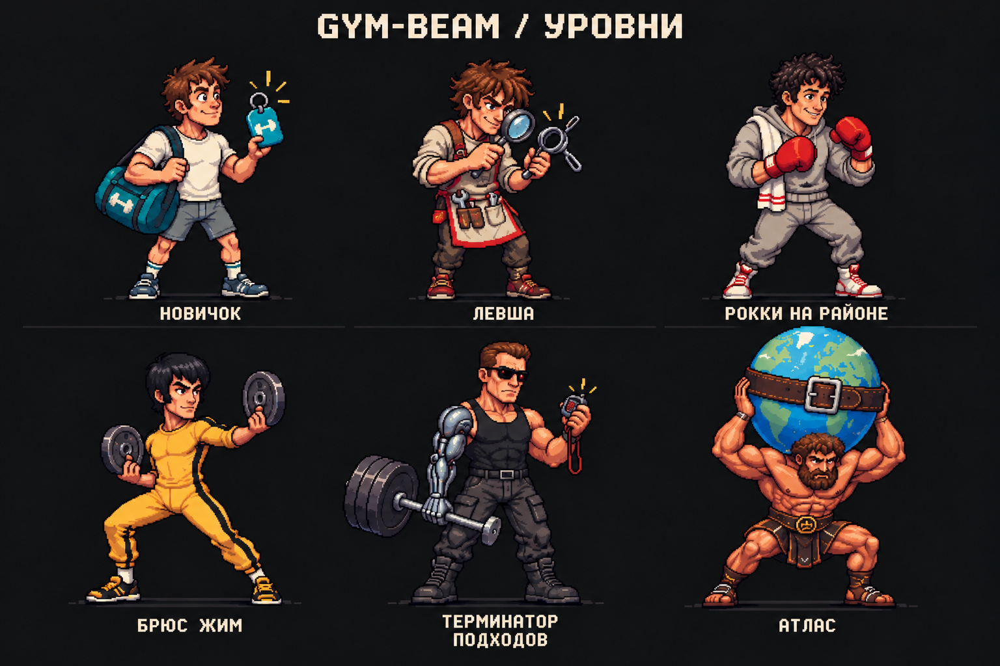

# Gym-Beam: Персонажи Уровней

АРХИВНЫЙ КОНЦЕПТ. 18.10.2026 пользователь попросил меньше русских сказок, больше кино и взрослую рисовку. Актуальное направление: [art-direction-v2.md](art-direction-v2.md), актуальный каталог: [catalog-v2.md](catalog-v2.md). Старый лист ниже оставлен только для сравнения.

Статус: концепция для обсуждения, 17.10.2026. В приложение не внедрена. Текущая опубликованная версия1.1.3; следующий завершённый выпуск с изменениями приложения будет1.1.4.

Лист создан встроенным image_gen, затем точечно исправлен Рокки: удалена красная повязка, добавлен узнаваемый серый тренировочный костюм. Это единый пробный лист, не шесть готовых прозрачных игровых спрайтов. [Оба промпта](style-study-v1.prompts.json).

## Что Обнаружено

Проверены81мужская и81женская пара «название/подпись»,243PNGфайла (81mobile,81web-male,81web-female), размеры/хеши и три сводные таблицы. Все исходные PNG1024x1024; все названия внутри каждой линейки формально уникальны. Проблема повторов смысловая, а не одинаковые строки.

1. В13слотах мобильная и веб-картинки различаются:0,4,9,13,18,22,31,36,40,49,58,72,80. Например, мобильные «Левша», «Святогор» и «Атлас» не имеют образов, соответствующих новым именам. В веб-наборе соответствующие персонажи уже есть.
2. На четырёх других именованных вехах обе версии оставили общие силуэты:27«Спартак»,45«Добрыня Никитич»,54«Алёша Попович»,63«Илья Муромец». Простое копирование13PNG не исправит всю галерею.
3. Значительная часть ступеней отличается цветом майки или размером мышц. «Мощный», «Мощный атлет», «Крепкий», «Крепыш» не создают81запоминающийся образ. Некоторые поздние картинки имеют резко отличающиеся ореолы/детализацию.
4. Начало перегружено близкими прозвищами про худобу и слабость. Более сильный комедийный материал: сумка, абонемент, очередь к стойке, монтаж из боевика, поиск маленького блина, таймер, уборка инвентаря.
5. Копирайтинг местами противоречит механике: «Жмёшь свой вес»/«полтора своих веса» нельзя обещать за уровень по любым трём упражнениям. «Техника безупречна» не следует из уровня. Боль, отсутствие страха травмы и обязательный рост каждую неделю тоже не годятся как наградные факты.
6. [Подписи](../../../lib/level-data/src/index.ts) имеют отдельную женскую линейку, но [mobile levelImages](../../../artifacts/gym-tracker-mobile/lib/levelImages.ts) не принимает пол, а [экран](../../../artifacts/gym-tracker-mobile/app/(tabs)/levels.tsx) всегда показывает мужской набор. Это следует решить вместе с моделью галереи, не маскировать случайной картинкой.

Диагностические таблицы и JSON: `artifacts/apk/verified/levels-audit-mobile.png`, `levels-audit-web-male.png`, `levels-audit-web-female.png`, `levels-audit.json`. Они составлены из исходных файлов только для сравнения, PNG приложения не редактировались.

## Художественное Правило

Отсылка должна считываться по силуэту, костюму и одному предмету, а не только по подписи. Персонажи живут в одной версии зала Gym-Beam. Это авторские комедийные переосмысления, не копии спрайтов или диалогов Punch Club.

- Цельный пиксель-арт: единый логический масштаб, контур, ракурс3/4 и направление света. Рабочий ориентир для проб:96x128логических пикселей; окончательный размер выбирается после проверки маленьких иконок.
- Полный рост, стабильная линия пола, одинаковый относительный размер головы. Предметы героя не должны превращать тело в незаметную деталь.
- Ограниченная общая палитра материалов, по3основных тона для кожи/ткани/металла. Одежда разных цветов; оранжевый и ледяной голубой связывают серию с Gym-Beam.
- Чёткий силуэт и один главный визуальный гэг. Деталь, не читающаяся в48x48, не может быть единственным способом узнать героя.
- Финальные изображения: настоящий прозрачный фон, без встроенных названий/номеров, шумных частиц, случайного свечения и остатков подписей. Текст рисует интерфейс.
- Название преимущественно до24символов, исключения проверяются в интерфейсе. Подпись обычно35–75символов, одна законченная шутка.
- Юмор про привычки и ситуации. Уважительное отношение к начинающему, без обещаний о его теле, технике или результатах, которых приложение не измеряло.
- Игровое прозвище и спортивный норматив остаются разными понятиями. Числа WRPF, единицы, разряды и правила любых трёх упражнений не переписываются ради шутки.

Основа технического подхода: [арт-гайд Punch Club, опубликованный Alex Nichiporchik по материалам арт-директора Lazy Bear Games](https://www.gamedeveloper.com/production/punch-club-s-guide-to-pixel-art). Особенно полезны единый масштаб пикселей, контуры и палитра материалов. Это направление для нашей серии, не требование копировать все особенности игры.

## Шесть Пробных Образов

Номера большинства новых образов пока не назначены: сначала утверждаются тон и рисовка, затем полная последовательность. «Новичок» предлагается для0, «Атлас» сохраняется как кандидат для80. Нормативы от этого не меняются.

| Персонаж | Черновая подпись | Визуальная шутка |
| --- | --- | --- |
| Новичок | Сумка собрана. Осталось победить диван. | Брелок от зала как первый трофей |
| Левша | Плюс полкило. Ювелирная работа. | Изучает замок грифа через лупу |
| Рокки на районе | Монтаж закончился. Подходы всё ещё настоящие. | Боксёр из тренировочного монтажа в обычном зале |
| Брюс Жим | Без дублёра. Но со страховкой. | Знакомый жёлтый костюм, вместо оружия блины |
| Терминатор подходов | Вернусь. Как только закончится таймер. | Киборг ждёт отдыха по маленькому секундомеру |
| Атлас | Держишь мир. Блины всё равно на место. | На земном шаре застёгнут тяжелоатлетический пояс |

Персонажи и подписи выше предложены, а не утверждены пользователем. У пробного листа ещё не проверена читаемость каждого героя в реальных48x48/100x100 на Android. У Левши и новичка нужно сильнее различить причёску/силуэт; атрибуты и мелкие детали упростить при создании отдельных иконок. Прозрачность и точная пиксельная сетка проверяются на производственных спрайтах, не по этому постеру.

## Структура Всей Лестницы

Сохраняем81числовой ID0–80 и девять существующих групп по9ступеней. Сначала составляем таблицу всех81строк: ID, имя, подпись, референс, силуэт/предмет, решение сохранить/переработать/заменить. Каждое имя должно иметь собственную идею, а не быть очередным синонимом слова «сильный».

Предлагаемые главы для внутреннего сценария, не новые вкладки приложения:

1. **0–8:** первый абонемент и бытовые противники.
2. **9–17:** дворовая школа и тренировочные монтажи.
3. **18–26:** находчивость, дисциплина, мастерство движения.
4. **27–35:** герои видеосалонов.
5. **36–44:** аркадные чемпионы.
6. **45–53:** железная фантастика.
7. **54–62:** богатыри и мифы.
8. **63–71:** противники финального босса.
9. **72–80:** легенды Gym-Beam.

Отсылки можно смешивать между главами. Это не канонический рейтинг силы персонажей разных вселенных и не обещание, что любой мифический герой буквально сильнее любого киношного.

## Решение О Галерее

Пользователь выбрал общую галерею, включая женских персонажей, независимо от пола профиля. Пол профиля по-прежнему влияет на нормативы. У каждой ступени будет одно имя, одна подпись и один рисунок: персонаж награды не является изображением самого пользователя. Старые женские подписи и файлы пока не удаляются: переход должен быть согласован между потребителями данных и проверен отдельно от спортивных расчётов.

Продолжение от 18.10.2026: [полный черновой каталог 81 ступени](catalog-v1.md), [структурированный источник](catalog-v1.json). Общая галерея утверждена, конкретные имена и подписи пока редакторский вариант. Никакие новые названия ещё не попали в приложение.

## Порядок Внедрения

1. Модель общей галереи утверждена. Уточнить тон пробного листа и любимые старые образы; в следующих эталонах обязательно показать героинь.
2. Подготовить всю таблицу81ступени и проверить логику последовательности. Хорошие идеи сохранять, но не считать старый PNG автоматически подходящим по качеству.
3. Создать6отдельных эталонных спрайтов с прозрачностью. Проверить настоящий альфа-канал, общий масштаб, ракурс и читаемость48x48/100x100.
4. Рисовать остальные партиями с эталонами и проверкой всей серии после каждой партии. Один JSON/манифест должен связывать ID с именем, подписью и рисунком, чтобы тексты и assets снова не разошлись.
5. Проверить0–80без пропусков, соответствие подписи/образа, источники изображений/профили, длинные подписи, тёмный фон, полный и компактный экран. Не допускать встроенных букв в игровых PNG.
6. Только затем логический выпуск1.1.4 с Russian notes, version bump, тестами, эмулятором и OTA/APK. Не менять прогресс, нормативы, ID или резервные копии ради оформления. До завершения не публиковать концепт как новую версию приложения.
