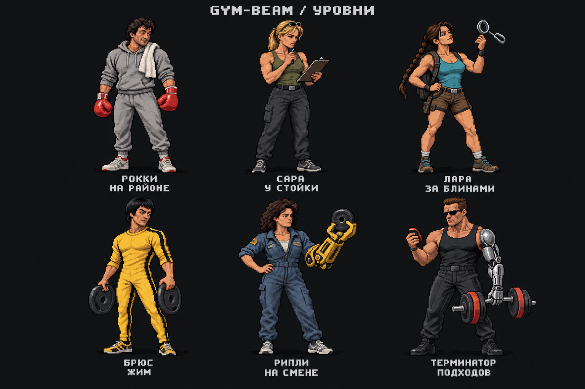

# Gym-Beam: Взрослая Галерея

ОБЛАСТЬ ИЗМЕНЕНА ПОЛЬЗОВАТЕЛЕМ: взрослый стиль утверждён, но теперь галереи раздельные по полу, женскую оставляем прежней. Продолжение: [мужская версия v3](art-direction-male-v3.md). Смешанный каталог v2 ниже не внедрять.

18.10.2026. Рабочая художественная концепция, не обновление приложения. Общая галерея для всех профилей утверждена пользователем. Новый запрос: меньше русских сказок, больше кино и других узнаваемых отсылок, аудитория взрослая.

Лист создан встроенным `image_gen`, без ключа тренера и без CLI/API fallback. [Точный промпт](style-study-v2.prompts.json). Это один концепт-лист, не шесть готовых прозрачных спрайтов. Старый милый вариант и его незавершённая партия отдельных рисунков отклонены как направление; не продолжать их генерацию.

## Подборка

[Полный каталог 81 ступени](catalog-v2.md), [структурированный источник](catalog-v2.json).

- 54 отсылки к кино, сериалам и экранным образам актёров.
- 14 персонажей игр.
- 2 отсылки к манге/аниме для взрослой аудитории.
- 9 оригинальных взрослых типажей повседневного зала.
- Левша как единичная литературная отсылка, Атлас как финальный мифический образ.
- В общей галерее 29 героинь и 52 героя. Это персонажи наград, не аватары пользователя.

Колобок, Иванушка, Василиса и линейка былинных богатырей исключены из нового черновика. Вместо них: Чувак из «Большого Лебовски», Форрест, Логан, Конан, Макклейн, Беатрикс, Геральт и другие взрослые экранные/игровые образы. Мюнхгаузен трактуется через взрослую ироничную кинотрадицию, Тор через экранный образ, а не детскую сказку.

Порядок глав остаётся условной историей зала, а не рейтингом силы разных вселенных. Не нужно спорить, сильнее ли Чудо-женщина Терминатора: это коллекция наград, не симулятор межвселенского боя.

## Визуальный Язык

- Взрослый аркадный пиксель-арт, примерно 6-6,5 голов по высоте человека; нормальные небольшие глаза, выраженная челюсть и нос, возрастные черты там, где они характерны. Никаких детских лиц и chibi-пропорций.
- Не все персонажи культуристы. У Рипли рабочая собранность, у Сары сухая атлетичность, у Брюса подвижный силуэт, у Терминатора тяжёлый корпус. Женщины не становятся «розовыми версиями» мужчин.
- Общие контур, масштаб пиксельных кластеров, ракурс 3/4, свет сверху слева и три основных тона материала. Разнообразие даёт силуэт и одежда, не разная техника рисования.
- В каждом образе один главный узнаваемый атрибут и одна бытовая нелепость: искательница артефактов находит замок грифа, промышленный захват берёт маленький диск, машина терпеливо ждёт таймер.
- Спортивная одежда и атрибуты характера, без оружия, крови, сцен насилия, порнографической стилизации, ауры и декоративного мусора.
- Финальные отдельные изображения будут с настоящим альфа-каналом, без текста и фона. Название и подпись выводит приложение.

Единый пиксельный масштаб, контуры и палитра материалов согласуются с [первичным арт-гайдом Punch Club](https://www.gamedeveloper.com/production/punch-club-s-guide-to-pixel-art). Конкретные образы, подписи и композиция создаются для Gym-Beam, не копируются из игры.

## Тон Подписей

Сухая ирония и узнаваемость ситуации. Взрослый тон не означает обязательный мат, пошлость, унижение новичка или романтизацию боли. Шутка должна работать и без узнавания фильма; отсылка даёт второй слой.

| Герой | Подпись |
| --- | --- |
| Чувак у стойки | Халат остался дома. Принципиальная позиция на месте. |
| Рокки на районе | Монтаж закончился. Подходы всё ещё настоящие. |
| Сара у стойки | Судный день перенесён. В календаре день спины. |
| Лара за блинами | Древний артефакт найден. Это второй замок от грифа. |
| Джон Уик без спешки | Карандаш при себе. Подходы сами не запишутся. |
| Терминатор подходов | Вернусь. Как только закончится таймер. |

Не использовать наградные подписи «техника безупречна», «жмёшь свой вес», «готов к соревнованиям», «веса растут каждую неделю»: игровой уровень не доказывает эти утверждения.

## Что Проверено

- Каталог содержит ровно 81 ID от 0 до 80 без перестановок и пропусков, 9 групп по 9 ступеней.
- 81 уникальное имя и 81 уникальная подпись, включая проверку регистра и «е/ё». Максимальная длина контролируется валидатором: имя до 24 символов, подпись до 80.
- Каждому ID сопоставлены референс, визуальная идея и решение о перерисовке/замене. Категории референсов покрывают все ID без повторов.
- Существует автоматическая проверка и негативные тесты: `node docs/design/levels/validate-catalog.mjs`, `node --test docs/design/levels/validate-catalog.test.mjs`.

Это проверки редакторских данных, не повторный прогон тестов приложения и не подтверждение готовности всех изображений.

## Следующий Этап

Сначала утвердить взрослый тон нового листа. Затем сделать отдельные прозрачные эталоны по этой рисовке; женские и мужские образы должны проверяться рядом. Большой старый лист и старые отдельные «милые» картинки не нарезать в финальные спрайты.

В новой пробе у Лары появился лишний набедренный карман, похожий на кобуру: в финальной версии убрать, оставить только маленький рюкзак. У Рипли упростить мелкую механику захвата, чтобы шутка читалась в 100x100. Читаемость лица, атрибута и силуэта проверить при 48x48 и 100x100 на тёмном фоне и в Android; сам концепт-лист такой проверки не заменяет.

Далее рисовать полную серию небольшими партиями, сопоставляя каждый рисунок с утверждённой таблицей. Только после готовности всех 81 образа согласованно подключить общие тексты и изображения к потребителям данных. Сохранить числовые ID и прогресс, раздельные нормативы по полу, WRPF и правило любых трёх упражнений.

Приложение остаётся 1.1.3/code9/runtime1.1.0. Следующий завершённый выпуск приложения 1.1.4, с обычными Russian release notes, проверками, OTA/APK. Для документации и художественных проб версию не повышать.
